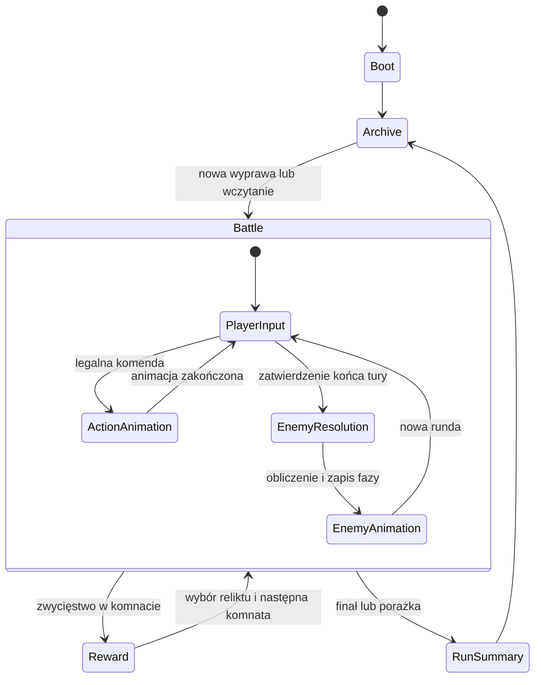

# Grid Legends: Echoes of the Void — projekt techniczny

Wersja 0.1 · specyfikacja, nie gotowa implementacja. Zasady źródłowe: [projekt gry](GAME_DESIGN.md).

## 1. Stos i zasady architektury

Proponowany stos: **TypeScript w trybie strict, Phaser 3, Vite, Vitest i Playwright**. Wersje należy przypiąć w lockfile podczas inicjalizacji implementacji. Node.js 22 LTS jest środowiskiem budowania. Serwer nie jest wymagany do gry single-player.

Phaser odpowiada za świat, sprite’y, kamerę, animacje, efekty i audio. HTML/CSS odpowiadają za czytelny tekst, karty, dialogi, przyciski i fokus. Żadna warstwa widoku nie odejmuje HP ani PA bezpośrednio.

**Rdzeń walki to czysta biblioteka TypeScript bez importu Phaser, DOM, audio, czasu rzeczywistego i storage.** Każda zmiana stanu jest wynikiem zwalidowanej komendy. Podgląd, rozgrywka, replay i testy korzystają z tej samej funkcji rozstrzygającej.

Przyszła struktura implementacji:

```text
src/
  core/
    model.ts                 # typy stanu, jednostek, komend i zdarzeń
    rules/                   # umiejętności, obrażenia, efekty i warunki końca
    grid/                    # współrzędne, BFS, raycast, zajętość
    ai/                      # planowanie intencji i stała kolejność
    reducer.ts               # walidacja i atomowe wykonanie komendy
    forecast.ts              # symulacja fazy na kopii stanu
    rng.ts                   # jawny generator seedowany
  content/                   # deklaracje klas, reliktów, pokoi i dialogów
  presentation/
    scenes/                  # sceny Phaser
    views/                   # obiekty mapy i jednostek
    effects/                 # animacje zdarzeń, bez reguł walki
    ui/                      # DOM, fokus, tooltipy i karty
    input/                   # mysz/klawiatura → komendy
  application/
    game-controller.ts       # synchronizacja logiki, zapisu i animacji
    persistence.ts           # transakcje zapisu, walidacja i migracje
    settings.ts
    localization.ts
  main.ts
public/assets/
  sprites/ audio/ fonts/
  licenses.json
tests/
  core/ scenarios/ e2e/
```

To docelowy układ plików, a nie opis plików już istniejących w repozytorium.

## 2. Model stanu i kontrakty

Poniższy fragment opisuje kontrakt, nie kompletny kod do skopiowania. Definicje zawartości umiejętności i archetypów są niemutowalne i identyfikowane przez `contentVersion`. Współrzędne przechodzą walidację zakresu; TypeScript sam nie ogranicza liczby do 0…7.

```ts
type UnitId = string;
type HeroClass = 'ignis' | 'kael' | 'lyra';
type AbilityId =
  | 'shieldBash' | 'lightWall'
  | 'preciseShot' | 'voidSnare'
  | 'timeLoop' | 'lightningStrike';
type Direction = 'N' | 'E' | 'S' | 'W';
type Cell = Readonly<{ x: number; y: number }>;
type Phase = 'player' | 'enemy' | 'reward' | 'won' | 'lost';

interface Unit {
  id: UnitId;
  archetypeId: string;
  team: 'heroes' | 'enemies';
  heroClass?: HeroClass;
  cell: Cell;
  hp: number;
  maxHp: number;
  shield: number;
  ap: number;
  readyRound: Partial<Record<AbilityId, number>>;
  rootedActivations: 0 | 1;
}

type EnemyIntent =
  | { actorId: UnitId; kind: 'move'; path: readonly Cell[] }
  | { actorId: UnitId; kind: 'line'; direction: Direction;
      range: number; damage: number }
  | { actorId: UnitId; kind: 'area'; anchor: Cell;
      width: 2; height: 2; damage: number }
  | { actorId: UnitId; kind: 'wait' };

interface Trap {
  id: string;
  cell: Cell;
  damage: number;
  expiresAfterEnemyRound: number;
}

type Tile = 'floor' | 'wall' | 'void';
interface BoardObject {
  id: string;
  kind: 'cover' | 'obelisk';
  cell: Cell;
  hp: number;
  maxHp: number;
}

interface BattleState {
  schemaVersion: number;
  contentVersion: string;
  round: number;
  phase: Phase;
  board: readonly (readonly Tile[])[]; // board[y][x], 8×8
  units: Readonly<Record<UnitId, Unit>>;
  objects: Readonly<Record<string, BoardObject>>;
  traps: readonly Trap[];
  enemyOrder: readonly UnitId[];
  intents: readonly EnemyIntent[];
  actionSequence: number;
}
```

Martwe jednostki są usuwane z mapy aktywnych jednostek. Rekord drużyny w stanie wyprawy przechowuje tożsamość, relikty i dane potrzebne do odtworzenia poległych po wygraniu komnaty. Pozycja z animacji nie jest pozycją logiczną.

```ts
type Command =
  | { type: 'move'; actorId: UnitId; destination: Cell }
  | { type: 'bash'; actorId: UnitId; targetId: UnitId }
  | { type: 'shield'; actorId: UnitId }
  | { type: 'shoot'; actorId: UnitId; direction: Direction }
  | { type: 'snare'; actorId: UnitId; cell: Cell }
  | { type: 'swap'; actorId: UnitId; firstId: UnitId;
      secondId: UnitId }
  | { type: 'lightning'; actorId: UnitId; anchor: Cell }
  | { type: 'endTurn' };

type Resolution =
  | { ok: true; state: BattleState; events: readonly DomainEvent[] }
  | { ok: false; reason: RuleError };

// DomainEvent i RuleError są osobnymi sumami rozłącznymi.
// To sygnatury planowanego API:
// reduce(state, command, content): Resolution
// simulateEnemyPhase(state, content): Resolution
// forecast(state, optionalCommand, content): Forecast
```

Komenda umiejętności sprawdza także klasę aktora. Ignis nie rzuci Pioruna przez ręczne wywołanie `lightning`, nawet jeśli ma 2 PA. Osobny `RunState` zawiera trasę, indeks komnaty, drużynę, relikty, RNG nagród i `pendingReward`. Osobny `ProfileState` zawiera Echa, odblokowania, kronikę oraz ustawienia. Operacje aplikacji `startRun`, `chooseReward`, `unlockRelic` i `resetProfile` są odrębnymi, walidowanymi komendami; nie wolno traktować ich jako akcji aktora walki. Nie należy dopisywać trwałych odblokowań do każdej jednostki walki.

Przykładowe zdarzenia: `UnitMoved`, `DamageApplied`, `ShieldGranted`, `UnitSwapped`, `TrapTriggered`, `UnitDied`, `ObjectDestroyed`, `IntentInterrupted`, `RoundStarted`, `RoomCleared`, `RunLost`. Każde zawiera stabilne ID, dane przed/po potrzebne do prezentacji i numer sekwencji; nie przechowuje referencji do obiektu Phaser.

## 3. Maszyna stanów i wejście



Diagram pokazuje przepływ aplikacji; stany animacji nie są dodatkowymi fazami reguł walki. Kontroler przechwytuje wynik końcowy przed wejściem do kolejnego `PlayerInput`.

Przetwarzanie pojedynczej akcji:

1. Widok wysyła komendę zawierającą `actorId`, bez zakładania, że wybrana karta UI jest uprawnieniem.
2. Kontroler sprawdza, czy poprzednia komenda nie jest właśnie przetwarzana.
3. Rdzeń waliduje fazę, klasę, HP, PA, odnowienie, pozycje, cel i zajętość pól.
4. Rdzeń tworzy nowy stan i zdarzenia; nie mutuje otrzymanego stanu.
5. Kontroler zapisuje stan atomowo i przekazuje zdarzenia do kolejki animacji.
6. UI blokuje nowe komendy do zakończenia animacji lub jej pominięcia. Kliknięcia nie czekają w niewidocznej kolejce.
7. Widok synchronizuje się ze stanem i ponownie udostępnia wejście.

Cała faza przeciwników jest jedną operacją logiczną z szeregiem animowanych zdarzeń. Zamknięcie karty w środku animacji odtworzy jej **wynik**, a nie częściowo wykonanych wrogów. Nie obliczamy obrażeń w callbacku tweenu ani w `Scene.update()`.

## 4. Podgląd i AI

Funkcja podglądu klonuje stan, opcjonalnie stosuje proponowaną komendę, a następnie wywołuje ten sam symulator fazy przeciwników co `endTurn`. Zwraca prognozowany stan końcowy, listę zdarzeń oraz przyczyny zmian intencji. Symulacja nie zapisuje niczego na dysku, nie przyznaje Ech i nie odtwarza audio.

Sama intencja pozostaje zablokowana w trakcie fazy gracza. Ponowne obliczenie podglądu **nie jest** ponownym planowaniem AI. Napastnik kierunkowy zachowuje kierunek, nie dawny `targetId`; Tkacz zachowuje kotwicę obszaru. ID celu użytego przy planowaniu może występować w opisie diagnostycznym, lecz nie może powodować śledzenia celu.

Wynik podglądu musi uwzględniać kolejność. Przykład: jeśli pierwszy wróg zabije drugiego własnym pociskiem, drugi nie wykonuje zapowiedzianego ataku. Liczenie każdego przeciwnika na osobnej kopii początkowej planszy byłoby błędem.

Operacje na siatce:

- BFS wyznacza zasięg ruchu i ścieżkę z blokowaniem jednostek oraz obiektów.
- Raycast ortogonalny zatrzymuje się na pierwszej jednostce lub przeszkodzie; otchłań nie zatrzymuje promienia.
- AoE korzysta z jawnej maski czterech pól i walidacji kotwicy 0…6.
- Swap zapisuje obie nowe pozycje w jednej operacji, a dopiero potem bada pułapki.
- Kolejność remisu jest częścią reguł, nie przypadkowym porządkiem iteracji po mapie lub DOM.

Losowość występuje tylko przy wyborze szablonów, tras i nagród. Propozycja generatora: jawny `xoshiro128**`, stan czterech liczb uint32, własne testy wektorów referencyjnych. Nie używamy `Math.random()` ani czasu zegarowego w rdzeniu. Każdy run przechowuje seed, stan generatora i wersję algorytmu. Dla jednego seedu i sekwencji komend wynik jest identyczny w Chrome i Firefox.

## 5. Dane zawartości i walidacja map

Umiejętności, relikty i pokoje mają stabilne ID; polskie nazwy są kluczami lokalizacji, nie kluczami reguł. Definicje przechowują koszt PA, C, zasięg, obrażenia i identyfikator implementacji efektu. Relikt nakłada jawny modyfikator tych danych, bez wykonywania dowolnego tekstowego skryptu.

Każda mapa przechodzi walidację przed uruchomieniem:

- Dokładnie 8 wierszy po 8 kafelków; wszystkie współrzędne mieszczą się w zakresie.
- Żadnych nakładających się jednostek, osłon, Obelisku i niedozwolonych startowych pułapek.
- Żywe jednostki zaczynają na posadzce; istnieje dokładnie jeden Obelisk wymagany przez cel.
- Gracz ma trzy legalne miejsca startowe, a od pierwszej rundy istnieje legalna akcja.
- Przynajmniej jedna trasa prowadzi do obszaru starcia; cel nie jest odcięty nieusuwalnymi ścianami.
- Ręcznie przygotowany seed otwarcia ma sprawdzone rozwiązanie testowe. Sam BFS nie dowodzi taktycznej wygrywalności.

MVP używa zatwierdzonych szablonów bez losowego rozmieszczania przeszkód. Późniejsze odbicia i obroty muszą przekształcać również kierunki, spawn, cele i maski. Nie generujemy losowej mapy, a następnie nie naprawiamy jej ukrytymi teleportami.

## 6. Zapis i reset linii czasowej

MVP nie wymaga konta. Zapis lokalny zawiera: `schemaVersion`, `contentVersion`, profil, aktywny run, stan walki, zapisane intencje, odnowienia, seedy, licznik akcji i oczekującą nagrodę. Rejestrowanie komend do replaya jest pomocne, ale migawka stanu pozostaje podstawą wczytania.

Preferowany nośnik: IndexedDB. Profil i aktywna wyprawa są zapisywane w jednej transakcji, tak aby przyznanie Echa i zaliczenie pokoju nie mogły rozdzielić się przy przeładowaniu. Wynik pokoju ma unikalny identyfikator `(runId, roomIndex)` i znacznik rozliczenia. Ponowne wyświetlenie ekranu nagrody niczego nie przyznaje.

Jeśli IndexedDB jest niedostępne, dopuszczony fallback zapisuje **cały envelope** pod jednym kluczem localStorage, zamiast oddzielnie aktualizować walutę i run. Jeśli oba mechanizmy zawodzą, gra jawnie przechodzi w sesję bez zapisu i ostrzega przed rozpoczęciem lub kontynuacją. Nie wyświetla „zapisano” po wyjątku.

Zapisy powstają po każdej legalnej komendzie, rozliczeniu walki i wyborze nagrody. Na ekranie nagrody `pendingReward` jest zapisane przed możliwością wyboru; reload nie losuje nowej trójki. Po przegranej aktywny run ma stan zakończony, a profil zostaje zachowany. „Nowa wyprawa” nie znaczy „usuń profil”. Reset profilu jest osobną potwierdzaną operacją.

Wczytanie waliduje dane jak niezaufane wejście. Nieznanego lub uszkodzonego formatu nie nadpisujemy automatycznie; oferujemy eksport, czytelny komunikat i nowy run. Migracje są jawne i testowane. Zmiana reguł walki w nowszym `contentVersion` wymaga migracji albo świadomego zakończenia starego runu z zachowaniem profilu — nie wolno po cichu przeliczać go według innych zasad.

Dodatkowo: ręczny eksport/import pliku JSON z walidacją schematu. Nie ma gwarancji ochrony przed świadomym edytowaniem lokalnego zapisu; single-player offline nie wymaga serwera antycheat.

## 7. Renderowanie, błędy i zasoby

Sceny: `BootScene` ładuje minimalny ekran, `PreloadScene` pokazuje postęp, `ArchiveScene` obsługuje profil i nowy run, `BattleScene` wyświetla walkę, `ResultScene` — podsumowanie. Przejścia odpinają listenery DOM i niszczą poprzednie efekty, by powtarzane runy nie kumulowały obiektów.

Phaser używa `pixelArt: true`, kamery z zaokrąglaniem pikseli i `Scale.FIT`. DOM jest pozycjonowany według obszaru sceny i skaluje tekst niezależnie. Dla obsługiwanych ekranów porządkujemy trzy regiony tak, żeby plansza i akcje nie nachodziły na siebie.

Glow i światło nie są warunkiem uruchomienia. W WebGL można wykorzystać światło 2D i normal mapy dla gotowych assetów; fallback stosuje halo i sprite’y addytywne. Przy braku renderera gra wyświetla komunikat z przyczyną i ponowną próbą, zamiast pozostawiać pusty ekran. Tekstury awaryjne zastępują brakujący opcjonalny efekt, ale brak podstawowego tilesetu zatrzymuje start z nazwą brakującego zasobu.

Budżety do zmierzenia w prototypie: początkowy transfer gry do 10 MB skompresowanych danych, do 200 aktywnych cząsteczek, do 20 jednostek, cel 60 FPS przy 1280×720 na urządzeniu referencyjnym opisanym w raporcie pomiaru. Wyłączenie efektów ma utrzymać czytelność. Spadek liczby klatek nigdy nie zmienia wyniku walki.

Audio wymaga gestu użytkownika. Nieudane odblokowanie Web Audio pozostawia działającą grę z wyciszeniem. Assety i fonty są hostowane razem z grą, bez wymaganych zewnętrznych CDN. Nie dodajemy telemetrii ani wysyłki zapisów bez oddzielnej decyzji produktowej.

## 8. Budowanie i GitHub Pages

Docelowe komendy implementacji: `npm ci`, `npm run dev`, `npm run typecheck`, `npm test`, `npm run build`. Nie są jeszcze dostępne w repozytorium zawierającym wyłącznie tę dokumentację.

Vite powinien otrzymać `base: './'`. Wynik `dist/index.html` musi odwoływać się do `./assets/...`, a nie do `/src/main.ts`, `/src/main.js` lub `/assets/...` wskazujących katalog główny domeny. Dynamiczne zasoby należy budować względem `import.meta.env.BASE_URL` albo importować przez bundler. Ścieżek nie sklejamy na sztywno z `/`.

Workflow GitHub Actions:

1. Checkout.
2. Node.js 22 i `npm ci`.
3. Typecheck, testy rdzenia, build.
4. Test artefaktu pod ścieżką `/school_project/` z weryfikacją wszystkich żądań gry.
5. Publikacja **katalogu `dist`**, z uprawnieniami `pages: write` i `id-token: write`.

Źródło Pages w ustawieniach repozytorium musi być ustawione na GitHub Actions. Publikacja nie jest zakończona po samym pushu: trzeba potwierdzić sukces workflow i test na publicznym URL. Jeśli ma być wspierane publikowanie z gałęzi zamiast Actions, potrzebny jest osobny proces dostarczenia gotowych plików do wybranego katalogu. Nie należy publikować surowego HTML z importem TypeScript i oczekiwać działania w przeglądarce.

Bootstrap HTML zawiera widoczny stan ładowania. Nieudane załadowanie głównego modułu lub assetów pokazuje panel błędu z przyciskiem odświeżenia i informacją o nieudanym URL. To zabezpieczenie UX, nie zamiennik prawidłowego wdrożenia. W MVP nie dodajemy service workera, żeby uniknąć cache starego HTML wskazującego nieistniejące hashe plików.

## 9. Weryfikacja poprawności

Testy jednostkowe dotyczą reguł i legalności, scenariuszowe — interakcji wielu efektów, a E2E — rzeczywistego interfejsu oraz załadowania grafiki. Nie akceptujemy zastąpienia testu walki sprawdzeniem samego istnienia elementu canvas.

Najważniejsza własność:

`stan po wykonaniu fazy przeciwników === stan przewidziany przez podgląd tej samej fazy`

Porównanie obejmuje HP, pozycje, tarcze, pułapki, statusy, obiekty, fazę, rundę i intencje następnej rundy. UI nie musi pokazywać całej struktury stanu, ale pokazane konsekwencje nie mogą być sprzeczne z nią. Testy zapewniają także, że symulacja podglądu nie zmienia wejściowego stanu, RNG ani storage.

Szczegółowe przypadki i bramki dostarczenia zawiera [plan realizacji](DELIVERY_PLAN.md). Dokument nie stanowi raportu wykonania testów — implementacja, assety i pomiary dopiero powstaną.
